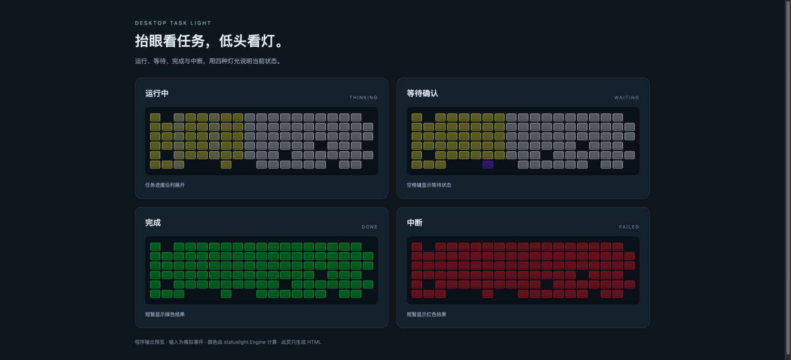

# 桌面任务状态灯

让键盘背光显示任务进度：黄色表示运行中，紫色表示等待确认，绿色表示完成，红色表示中断。



上图是运行 `preview.py` 得到的浏览器画面。颜色由实际状态机计算，输入使用模拟事件。

## 能做什么

- 并行任务按区域显示进度，结束后短暂显示结果。
- 通过 hook 接收任务开始、等待确认和结束事件。
- 连接支持的 USB RGB 键盘，控制逐键灯光，退出时恢复原灯效。
- 保留配置模板、模拟固件和回归测试，方便修改颜色与显示规则。

## 先看效果

需要 macOS 与 Python 3.8 及以上。

```bash
python3 preview.py
open preview.html
python3 -m unittest discover -s tests -p 'test_all.py'
```

预览只生成本地网页，使用四组模拟任务状态。真实灯光通信用途针对 Q5 HE ANSI / ISO / JIS 的 USB 接口实现。

## 连接设备

```bash
cp config.example.json config.json
python3 statuslight.py probe
python3 statuslight.py selftest --cycles 30
```

确认设备探测与回读测试通过后，运行 `bash install.sh` 安装后台服务。在 Codex 的 `/hooks` 中检查并信任本项目的 hook。`python3 statuslight.py pause` 暂停控制；`python3 statuslight.py resume` 恢复；`bash uninstall.sh` 卸载。

可选网络检测默认关闭。程序运行时会在本机读取任务元数据，并在 `state/`、`run/`、`logs/` 写入状态和日志。原有配置与数据保存在原来的安装目录，分享版本需单独配置。

## 文件

| 文件 | 用途 |
| --- | --- |
| `statuslight.py` | 事件处理、状态机、后台服务与命令行 |
| `q5he_hid.py` | USB HID 访问、设备识别与灯光协议 |
| `hook_relay.py` | 接收任务 hook |
| `preview.py` | 生成可重复查看的状态机预览 |
| `tests/` | 模拟固件与回归测试 |

截图展示模拟事件驱动的程序输出。设备运行效果由所连接键盘决定。许可和公开协议来源见 [NOTICE.md](NOTICE.md)。

## 作者

[ivy987654](https://github.com/ivy987654)，某不知名小厂的全栈开发。
